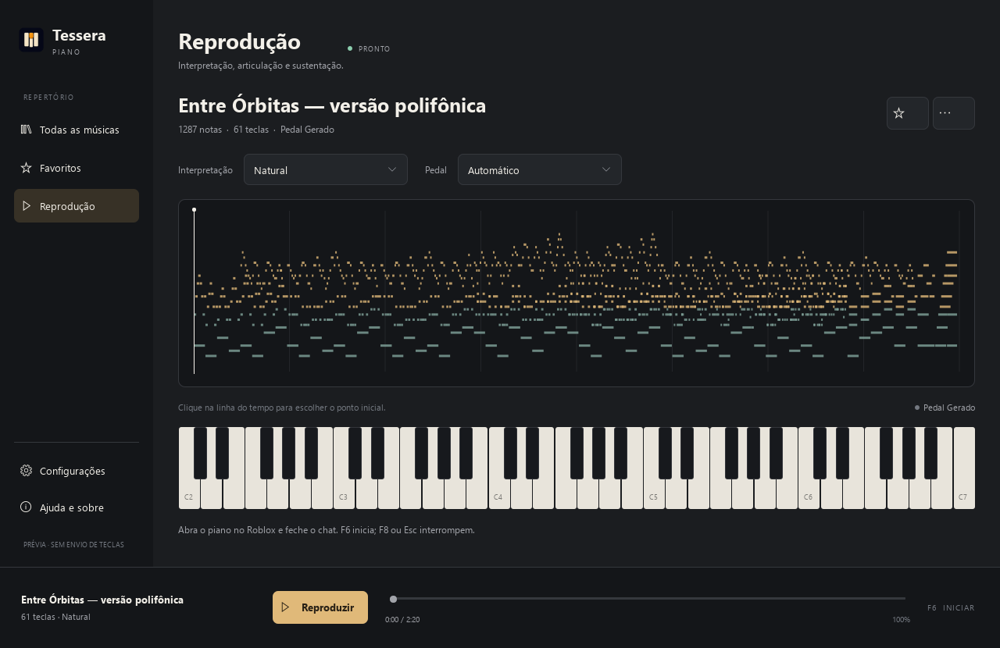

# Tessera Piano

Biblioteca de músicas e interpretação por teclado para [Visual Pianos](https://www.roblox.com/games/5593470048/Visual-Pianos) e pianos compatíveis no Roblox. Aplicativo para Windows 10/11 de 64 bits, com interface Qt Quick.



## Instalação

Baixe o instalador na página de [Releases](https://github.com/Bernardo-vignatti/TesseraPiano/releases/latest). Python e as bibliotecas necessárias já acompanham o aplicativo.

A branch principal também contém a [beta 4.2](https://github.com/Bernardo-vignatti/TesseraPiano/releases/tag/v4.2.0-beta.1), com interpretação local e orientação Chroma descritas abaixo. A 4.1.1 permanece no canal estável.

Na [primeira abertura](docs/images/setup.png), configure aparência, alcance do piano, interpretação e bandeja. Você também pode começar com os padrões e voltar ao assistente nas configurações.

## Como tocar

1. Importe um MIDI, `piano.json` ou partitura TXT, ou escolha uma música da coleção.
2. Escolha o alcance de 61 ou 88 teclas. Para 88, ative também **88key** no jogo.
3. Abra o piano no Roblox e feche o chat.
4. Pressione **F6** e selecione o jogo durante a contagem.
5. Na beta 4.2, **F8** conclui uma curta saída musical. **Esc** ou um segundo F8 interrompem imediatamente. Mudar de janela também interrompe o envio.

O aplicativo verifica se a janela selecionada pertence ao Roblox. Ele envia teclas pelo Windows, sem acessar a memória do jogo.

## Interpretação e pedal

- **Original:** mantém tempos e articulações, com as adaptações necessárias ao teclado físico.
- **Natural:** acrescenta fraseado discreto e pequenas diferenças de ataque.
- **Expressivo:** aumenta a presença dessas variações. A intensidade é ajustável.

O modo de pedal **Automático** usa CC64 quando presente e gera pedalização contextual quando o arquivo não tem esse controle. **Apenas MIDI**, **Ligado**, **Desligado** e **Manual** também estão disponíveis.

Na beta 4.2, o perfil automático sugere uma interpretação Contida, Cantabile ou Rítmica a partir da textura musical. Você pode escolher outro perfil e gerar uma nova variação. Análise e interpretação ficam salvas por conteúdo, faixas e ajustes, sem modificar a fonte.

Em **Configurações → Motor musical local**, instale o pacote opcional Pianist Transformer para preparar uma execução com modelo pré-treinado. O pacote CPU tem cerca de 480 MiB de download e ocupa 1,6 GiB; a instalação precisa de aproximadamente 2,5 GB livres. Depois de instalado, funciona offline. A preparação mostra progresso e pode ser cancelada; músicas longas podem levar minutos. Sem o pacote ou diante de um resultado inválido, o app informa que usou regras musicais.

No Visual Pianos, **Espaço solto liga a sustentação; Espaço segurado desliga**. Os testes de pedal e alcance nas configurações ajudam a conferir a resposta do instrumento. O teclado comum não transmite velocity; o volume das notas depende da entrada oferecida pelo jogo.

Importações antigas continuam funcionando. Para recuperar faixas, alturas ou pedal que uma versão antiga não guardou, reimporte o MIDI original. Novas importações preservam uma cópia da origem.

## Praticar com Razer Chroma (beta)

Selecione **Guiado** no player. Nas configurações, teste a sequência de luzes e confirme a iluminação no teclado. É necessário um teclado Razer compatível com controle individual pelo SDK, com as teclas exigidas pelo mapa e o serviço Chroma ativo. O Cynosa Chroma foi conferido fisicamente; outros modelos precisam da mesma confirmação. As 88 notas usam também Shift/Ctrl, não 88 teclas físicas distintas.

**Acompanhar** avança no ritmo escolhido; **Praticar** aguarda o grupo correto. Luz discreta antecipa o próximo grupo, brilho marca o ataque e a iluminação mantida orienta a duração. Shift/Ctrl e Espaço também são indicados. Você toca as notas e o pedal: esse modo não envia entradas sintéticas. O feedback mede as teclas físicas, não o áudio recebido pelo jogo.

Ajuste velocidade, antecedência e brilho conforme necessário. Use **Melodia simplificada**, **Acordes distribuídos** ou selecione faixas quando houver combinações incompatíveis. Distribuir mantém as notas e separa ataques e modificadores para a prática, alterando o ritmo do arranjo. A progressão opcional aumenta a velocidade entre repetições bem executadas. Para repetir um trecho, posicione o cursor, marque **A**, avance e marque **B**; **Limpar** desativa a repetição do trecho. A calibração permite corrigir posições das luzes em mapas físicos diferentes.

## Biblioteca e preferências

Os dados ficam em `%LOCALAPPDATA%\TesseraPiano`. Atualização e desinstalação preservam essa pasta. Favoritos, nomes personalizados e exclusões reversíveis continuam disponíveis após migrar da versão 3.1.

Temas claro, escuro e do sistema, redução de movimento, atalhos, importação por arrastar arquivos e modo bandeja estão nas configurações. **Ctrl+O** importa; **Ctrl+F** busca; **Ctrl+,** abre configurações.

Na reprodução, interpretação, pedal e alcance ficam no painel lateral. Em janelas menores, abra **Interpretação** para acessar os mesmos ajustes. O menu da música permite renomear e remover; as exclusões podem ser desfeitas nas configurações.

O aplicativo consulta novas releases no GitHub quando essa opção está ativada. Downloads são autenticados com manifesto assinado e SHA-256; a instalação acontece quando você escolher atualizar. Músicas e preferências não são enviadas. Não há telemetria.

## Desenvolvimento

Python 3.12 e um ambiente virtual:

```powershell
py -3.12 -m venv .venv
.venv\Scripts\python -m pip install -r requirements-dev.lock
.venv\Scripts\python -m pip install -e . --no-deps
.venv\Scripts\python -m tessera_piano
```

Consulte [desenvolvimento e distribuição](docs/development.md) para testes, prévia sem envio de teclas, compilação e publicação.

## Licença

O código próprio é [MIT](LICENSE). Músicas e dependências mantêm suas [licenças e atribuições](THIRD_PARTY_NOTICES.md).
