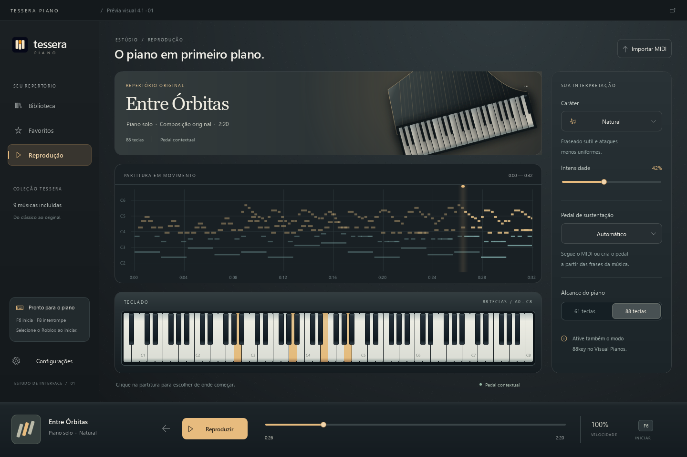
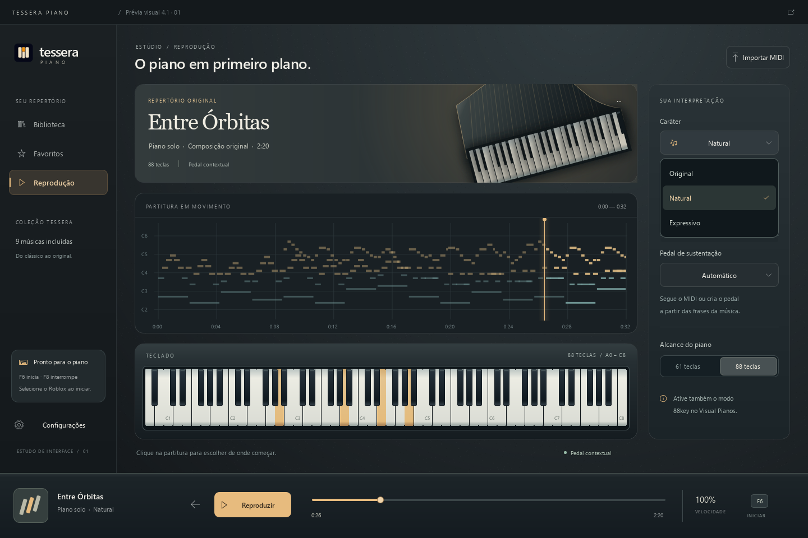

# Tessera Piano 4.1 — proposta 01

Status: estudo visual, anterior à implementação. Base: versão 4.0.1, commit `529efbc`. A versão instalada e o canal de atualizações continuam na 4.0.1.

## Direção: estúdio de câmara

Grafite, marfim e âmbar continuam reconhecíveis, agora com superfícies que lembram um instrumento: metal acetinado, iluminação lateral, bordas finas e teclas com profundidade. Linhas inspiradas nas cordas e na curva de um piano formam a arte do repertório. A composição é desenhada em QML/Canvas, sem fotos externas ou imagens geradas.

Das três referências fornecidas: camadas e contraste da primeira; presença de arte na área de destaque da segunda; materialidade e teclado esculpido da terceira. O conteúdo musical ocupa o centro. A cor aparece nas notas, na luz e nas ações principais.

- Navegação discreta à esquerda; transporte fixo embaixo.
- Música, partitura e teclado na área principal; interpretação, pedal e alcance em um painel lateral.
- Título editorial em Georgia e controles em Segoe UI, disponíveis no Windows. Numeração alinhada nos tempos.
- Textura estática de baixo contraste; luz âmbar localizada. Sem desfoque contínuo nem partículas animadas sobre a partitura.
- Na janela mínima, o painel de interpretação passa para uma seção recolhível. A partitura conserva espaço útil.
- Tema claro derivado dos mesmos materiais: papel, marfim e grafite. Não basta inverter as cores do tema escuro.





## Auditoria do repositório

Verificação em 10/11/2026 sobre `529efbc`: 106 arquivos, 4.354.263 bytes no conteúdo Git, quatro commits e 121 blobs históricos. Todas as branches e tags públicas existentes estavam representadas localmente. Relatórios detalhados ficam em `.local/audit`, fora do Git.

| Verificação | Resultado |
| --- | --- |
| Gitleaks 8.30.1, histórico completo, saída ocultando segredos | Um alerta revisado: `WHITE_KEYS` em `keymap.py:3` é o mapa público das teclas, não uma credencial. |
| Busca adicional em todos os blobs por chaves privadas, URLs com credenciais e caminhos pessoais | Nenhuma ocorrência encontrada. |
| E-mails e autoria | Autoria dos commits usa o endereço público `noreply` do GitHub. Contatos nos LilyPond pertencem às atribuições das edições Mutopia. |
| Metadados PNG | Sem chunks textuais ou EXIF nos PNGs versionados. Correspondências de e-mail dentro de dados PNG comprimidos foram descartadas como coincidências binárias. |
| Perfil, cópias antigas, logs, instaladores e ambiente virtual | Não estão versionados. |
| Atualização | O código contém a chave pública esperada; a chave privada não aparece no histórico analisado. |

A análise não encontrou dados pessoais do perfil do aplicativo nem credenciais publicadas. Ela cobre o conteúdo Git acessível e não constitui garantia sobre forks, caches externos ou mudanças futuras. Nenhuma reescrita de histórico é necessária pelos achados atuais.

### Limpeza proposta

| Material | Ação e motivo |
| --- | --- |
| `tessera-master.png` | Retirar do pacote e da árvore de fontes do app; guardar a matriz fora do código distribuído. Sozinha tem 1.505.209 bytes, 34,6% da árvore Git, sem referência de uso. |
| PNGs de ícone sem referências | Manter no app apenas o PNG usado e o ICO. Conferir os tamanhos incorporados ao ICO antes da remoção. |
| Imagens e textos exclusivos do instalador | Mover para `packaging`, evitando incluí-los na pasta de recursos do aplicativo. |
| Fontes MIDI/LilyPond e créditos | Preservar a procedência e as atribuições. Separar fontes de conversão dos recursos usados em execução, com referências atualizadas. |
| `docs/validation.md` | Consolidar os resultados históricos nas notas das releases; manter na documentação os comandos reproduzíveis. |
| Textos antigos no repertório | Atualizar nomes de versões e descrições de conversão. Remover a expressão “criada nesta conversa” dos metadados de Entre Órbitas, sem atribuir autoria inexistente. |
| `.gitignore` | Ampliar a exclusão de variantes de `.env`, arquivos de credenciais e relatórios locais; manter exemplos de configuração intencionais. |

Excluir um arquivo em um commit novo não o apaga de commits anteriores. A limpeza proposta reduz a árvore atual e o pacote; não exige apagar as tags das versões publicadas.

## Menus e comportamento

A inspeção identificou `Menu`/`MenuItem` e diálogos com botões padrão em `PlayerPage.qml`, `CheckDelegate` para faixas, slider padrão nas configurações e `QMenu` separado na bandeja. Esses caminhos não compartilham os mesmos componentes visuais. O teste de interface atual chama renomeação e exclusão pelo backend; não exercita os respectivos diálogos.

| Área | Mudança prevista | Critério de aceite |
| --- | --- | --- |
| Menu da música | Painel comum com ícones, foco visível e ação de remoção diferenciada | Abrir, navegar com setas, confirmar e fechar com Esc; restaurar foco ao botão. |
| Renomear e remover | Diálogo compartilhado; ações com nomes específicos e campo no mesmo padrão | Enter confirma somente uma vez; Esc cancela; nome válido e foco inicial corretos. |
| Faixas | Seletor com indicação de faixas ativas e checkboxes consistentes | Percorrer listas longas com teclado e mouse; nenhuma faixa inacessível por corte. |
| Seletores e dicas | Tipografia, bordas, estados e transições comuns | Reposicionamento nas bordas, contraste e navegação por teclado em ambas as aparências. |
| Bandeja | Aplicar a identidade ao menu Qt Widgets e sincronizar estados habilitados | Abrir sem janela principal; parar e sair sempre acessíveis; conferir o menu real no Windows. |
| Arquivos | Preservar o seletor nativo do Windows | Aparência conforme o sistema, acessibilidade e atalhos de arquivos mantidos. |
| Animações | Hover de 120 ms; menus de 160 ms; páginas de 220 ms, deslocamento de até 8 px e easing suave | Sem espera para ações; interrupções suaves e opção de reduzir movimento respeitada. |

Menus internos podem usar `Popup.Item` para manter estilo e comportamento previsíveis. A bandeja e o seletor de arquivos precisam de validação específica no Windows; a captura QML não cobre essas superfícies.

## Sequência de implementação e versão

1. **Repositório:** limpeza referenciada, créditos preservados, prevenção de segredos no CI com exceção restrita ao mapa de teclas. Commit independente.
2. **Fundação visual:** materiais e tokens comuns; componentes de menu, campo, diálogo, tooltip e slider. Substituir componentes existentes, evitando duplicar estilos por página.
3. **Telas:** aplicar a direção à reprodução e biblioteca, depois configurações, ajuda, importação e primeira abertura. Conferir tema claro, tema escuro e janela mínima.
4. **Interação:** animar mudanças de estado; exercitar menus e diálogos reais, foco, cliques rápidos, escalas de 100%, 150% e 200%, bandeja e movimento reduzido.
5. **Release 4.1.0:** atualizar a definição central de versão e changelog depois da implementação. Rodar lógica, interface, compilação e atualização 4.0.1 → 4.1.0 com recuperação antes da tag pública.

Esta proposta usa a branch `codex/4.1-design-review`, revisão visual `01`. Os commits da proposta não geram instalador nem alteram a release estável. Após avaliação, a implementação parte desta direção e os arquivos de estudo podem ser substituídos pelas capturas e componentes finais.

## Reproduzir a prévia

Na raiz do repositório, com as dependências de desenvolvimento instaladas:

```powershell
.venv\Scripts\python docs\design\4.1\render.py
```

As duas capturas são feitas pelo Qt a partir de `Preview.qml`. O protótipo usa notas do repertório incluído e estado de demonstração; não carrega perfil pessoal, atualizador ou saída de teclado. Seletores, intensidade e transporte funcionam apenas como demonstração local. Não é uma captura da versão já instalada.

## Fontes consultadas

- [Microsoft: Mica](https://learn.microsoft.com/en-us/windows/apps/design/style/mica) — hierarquia de materiais e contenção do efeito de fundo; a proposta desenha seus próprios materiais e não presume suporte a Mica no Windows 10.
- [Qt: Popup](https://doc.qt.io/qt-6/qml-qtquick-controls-popup.html) e [Menu](https://doc.qt.io/qt-6/qml-qtquick-controls-menu.html) — tipos de popup e limitações de personalização de menus nativos.
- [Arturia: Piano V](https://www.arturia.com/products/software-instruments/piano-v/overview) — referência de organização de um instrumento virtual. Nenhum recurso visual foi copiado.
- [Gitleaks, release 8.30.1](https://github.com/gitleaks/gitleaks/releases/tag/v8.30.1) — scanner utilizado, com checksum do arquivo conferido antes da execução.
